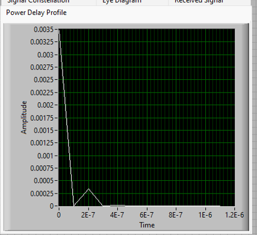
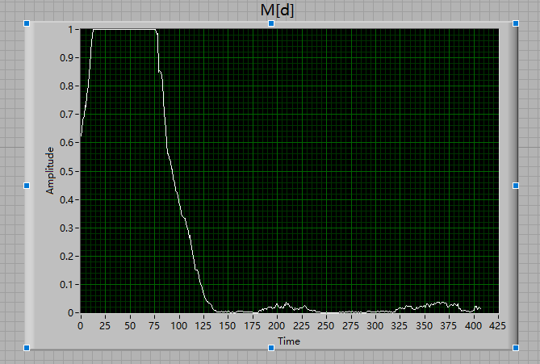

# LabVIEW / USRP 数字通信收发模块

这里是我用 LabVIEW 编写的数字通信收发模块，覆盖调制、脉冲成形、符号定时、均衡、帧同步、频偏估计和 OFDM，曾在 NI USRP-2920 上用于实机收发。

**这个仓库不能直接运行。** 只放了我自己编写的 VI，顶层收发程序和射频接口没有包含。可以用 LabVIEW 打开单个 VI 查看程序框图。

## 模块

| 文件夹 | VI | 功能 |
|---|---|---|
| `01_source_and_ber` | `student_source 2 finish`、`student_error_detect finish` | 比特源和误码统计 |
| `02_modulation_and_pulse_shaping` | `hanwang_modulate finish`、`wanghan_decode` | 符号映射和最大似然判决 |
| `02_modulation_and_pulse_shaping` | `hanwnag_pulse_shaping finish`、`hanwang_matched_filtering finish` | RRC 成形和匹配滤波 |
| `03_symbol_timing` | `hanwang_align_MaxEnergy`、`hanwang_align_ELgate 1` | 最大能量和早迟门符号定时 |
| `04_equalization` | `hanwnag_toeplitz 3`、`hanwang_LLSE 2`、`hanwnag_direct_equalizer 1` | Toeplitz 训练矩阵、最小二乘求解和直接均衡 |
| `05_frame_sync_and_cfo` | `hanwnag_sliding_correlator 1`、`hanwang_moose` | 滑动相关帧检测和 Moose 频偏估计 |
| `06_ofdm` | `hanwnag_OFDM_modulator 1`、`hw_OFDM_demodulator 2` | OFDM 调制和解调 |
| `06_ofdm` | `student_OFDM_FEQ 1`、`hanwang_OFDM_SchmidlCox 1` | 频域均衡和 Schmidl-Cox 帧同步 |

## 实验观察

以下来自实验记录，不是这个仓库能复现的结果。

- **频偏：** 系统理论可校正 ±4.545 kHz。频偏超过 3.6 kHz 时，相关检测峰值塌陷，星座旋转弥散，BER 约 0.5。
- **定时：** 符号率 1 MHz 下，过采样倍数 N 从 2 增加到 20，定时网格变细，星座随之收敛。
- **脉冲成形：** 滚降系数增大时，眼图水平张开，码间干扰减小，噪声带宽增大。
- **FFT 窗（仿真）：** 定时估计偏小并落入循环前缀时可以容忍；偏大则进入下一符号，几乎整帧出错。

## 实验截图

宽带链路的功率时延分布，主径后 0.2 μs 处有一条次径：

Schmidl-Cox 度量 M[d]，可以看到循环前缀带来的平顶：

## 环境

LabVIEW 2022 Q3（64 位）、NI-USRP 驱动、NI USRP-2920。
